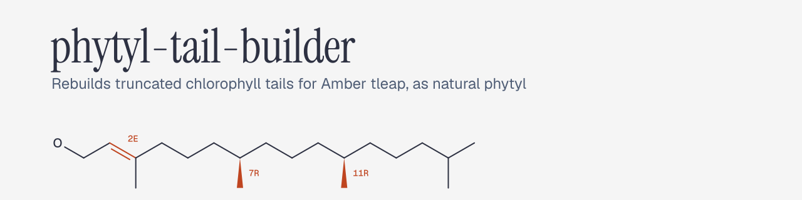
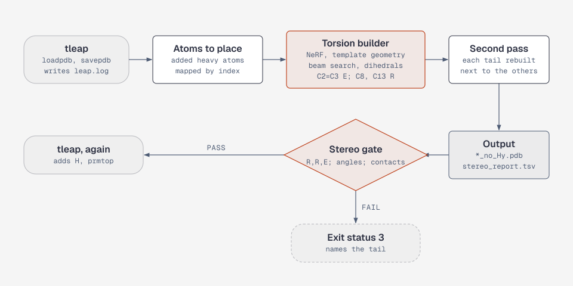

<p align="center">
  <picture>
    <source media="(prefers-color-scheme: dark)" srcset="assets/banner-dark.svg">
    
  </picture>
</p>

<p align="center">
  <a href="https://github.com/ViktorVanVaughn/phytyl-tail-builder/actions/workflows/ci.yml"></a>
  
  
</p>

Cryo-EM and X-ray models of chlorophyll proteins often stop the phytyl tails a few carbons after the ring, or leave them out. Amber `tleap` adds the missing heavy atoms from the residue template, but it places them without looking at their surroundings: tails come out with a Z double bond or with atoms inside other atoms, and a centre that is already inverted in the deposited model stays inverted. In the example shipped here, one tail carbon sits 0.35 Å from a side-chain carbon of its own chlorophyll.

**phytyl-tail-builder** takes the `leap.log` of that `tleap` run (the log `tleap` appends to in the folder where it runs) and rebuilds every added atom. It uses the template's bond lengths and angles, scans only the backbone dihedrals for the conformation with the fewest clashes, and makes every tail natural (2E,7R,11R) phytyl. It then checks the result and stops if a tail is wrong. The output is a hydrogen-free PDB for a second `tleap` run, which adds the hydrogens and writes the topology.

## Install

```bash
git clone https://github.com/ViktorVanVaughn/phytyl-tail-builder.git
cd phytyl-tail-builder
pip install .
```

Python 3.9 or newer; the dependencies are `numpy` and `scipy`. This installs two commands, `phytyl-tail-builder` and `phytyl-tail-check`. AmberTools is needed only for the `tleap` runs before and after. Phytyl residues are recognised by their atoms, named as in the PDB (CGA, O2A, C1–C20): CLA and CHL (chlorophyll *a* and *b*), BCL, PHO and the other chlorophylls and pheophytins.

## Quick start

From the cloned folder, on the example that ships with the code:

```bash
cd examples/minimal
phytyl-tail-builder --tleap-in tleap.in --leap-log leap.log --fix-resolved-stereo
phytyl-tail-check LCC_no_sc_no_Hy.pdb
```

The first command rebuilds the 12 truncated tails of the example in about 10 seconds. It warns that six residue types have no template (the C-termini of the cut protein fragments, which it leaves alone) and that two tails have a wrong configuration in the deposited model, rebuilds those too, and ends with

```text
Residue CHL 711: Average clash score per atom = 0.20
Residue CLA 717: Average clash score per atom = 7.33
Residue CHL 719: Average clash score per atom = 0.18
Output: LCC_no_sc_no_Hy.pdb
```

It writes `LCC_no_sc_no_Hy.pdb` and `stereo_report.tsv`, which match `expected/torsion-fix-resolved/`. The output is named after the `savepdb` file of `tleap.in` (`LCC_no_sc.pdb`) with `_no_Hy` added; `-o` sets the folder it goes to. The second command checks the new file and exits with status 0: all 12 tails pass. Leave out `--fix-resolved-stereo` and the run stops with status 3 instead, naming the two tails that were wrong before it started.

On your own system, run it where you ran `tleap`. Of `tleap.in` it reads only the `loadpdb` and `savepdb` lines. It needs one `<RESNAME>.mol2` template per rebuilt residue type (for example `CLA.mol2`, `CHL.mol2`) and stops if a phytyl residue has none; point `--templates` at their folder if they are not next to `tleap.in`:

```bash
phytyl-tail-builder --tleap-in tleap.in --leap-log leap.log --templates params/ -o build
```

Then load `build/<savepdb name>_no_Hy.pdb` in `tleap` with the same force fields to add the hydrogens and write the topology ([`examples/tleap_rebuild.in`](examples/tleap_rebuild.in) does this for the full system of the paper). Minimise before MD.

## How it works

<p align="center">
  <picture>
    <source media="(prefers-color-scheme: dark)" srcset="assets/algorithm-dark.svg">
    
  </picture>
</p>

1. **Atoms to place.** The `Added missing heavy atom` lines of the last `tleap` session in `leap.log` give the atoms. `tleap` numbers residues one after another from the resSeq (the PDB residue number) of the first residue of the `loadpdb` file, so each residue is found by that index. It must have the same name in the `loadpdb` and `savepdb` files, and every input atom must be at the same coordinates in both; anything else stops the run. The `.mol2` template of each residue gives the bonds, oriented outward from the atoms that are present.

2. **Torsion builder** (the default). Each missing atom is placed from three bonded atoms already in place (NeRF, the natural extension reference frame), with the template's bond length and bond angle. Only the backbone dihedrals are free: O2A–C1, C1–C2, and C3–C5 onwards. C1-C2-C3-C5 is fixed at 180°, so C2=C3 is E. Each methyl branch sits at the template's dihedral offset from its chain neighbour, on the side that makes C8 and C13 *R*. The ester and ring dihedrals come from the template, and resolved atoms are never moved. The free dihedrals are scanned in 10° steps with a beam search: at each free dihedral only the 5 best partial tails so far are extended, at most one per 30° cell of their free dihedrals, so the beam does not fill with near-copies of one conformation.

3. **Clash score.** Each trial atom is scored against the atoms within 4.5 Å, found with a KD-tree: Lennard-Jones 12-6 against the tail built so far, Mie 16-6 against everything else, with σ the mean of the two elements' values (C 3.40, N 3.25, O 2.96, H 2.65, Mg 1.16, S 3.56, P 3.74 Å, from R<sub>min</sub>/2 of parm99/GAFF, of `hc` for H and of `CLX.frcmod` for Mg). Each pair term is shifted to zero at 4.5 Å, so the score changes smoothly as atoms come and go. The atom's 1-2 and 1-3 partners are left out, since its bond length and angle fix their distances. The printed score per atom is near zero for a tail with room and large for a tight one (7 for CLA 717 in the example).

4. **Second pass.** Residues are built in order of increasing number of atoms to place, and in the first pass each tail is built without the tails that come after it. The second pass rebuilds every tail with all the others in place (`--passes`, default 2).

5. **Output and gate.** The PDB is written with the hydrogens of the rebuilt residues removed, together with `stereo_report.tsv`. If a rebuilt tail is not (R,R,E), has a tail bond angle more than 20° from its value in natural phytyl, or has a heavy atom within 2.0 Å of another heavy atom, the command exits with status 3.

`--builder sphere` keeps the v0.1 method, with the fixes of this version, for comparison: each atom is moved over 200 directions around its parent and the lowest score wins. It has no angle, dihedral or chirality term, and on the example none of its 12 tails passes the check.

## The stereo check

Natural phytyl is (2E,7R,11R). With the template atom names the centres are **C8** and **C13**, and the double bond is **C2=C3**, E when C1-C2-C3-C5 is near 180°. Amber's force field has no term that would restore an inverted centre or a Z double bond, and `tleap` adds the hydrogens wherever the heavy atoms leave room, so an error at this stage stays through minimisation and MD.

R and S come from the sign of the signed volume at each centre, calibrated on the tail of `examples/minimal/CLA.mol2`, which is (2E,7R,11R) by CIP; the tests check the calibration. A centre within 0.05 ų of planar gets no label, since its sign would only reflect rounding. Each tail bond angle is compared with its value in that natural tail and fails more than 20° off: thermal motion at 300 K spreads these angles by about 4°, while a misplaced atom gives 160–180°. A tail also fails if one of its heavy atoms is within 2.0 Å of a heavy atom more than three bonds away, since atoms that close overlap.

Every run writes `stereo_report.tsv`, one line per rebuilt residue:

| Column | Content |
|---|---|
| `residue`, `resseq`, `resname` | position in the file (from 1), resSeq and name |
| `C8`, `C13` | R, S, or `-` (missing atom or planar) |
| `C2=C3`, `C1-C2-C3-C5` | E (\|dihedral\| ≥ 150°), Z (≤ 30°), twisted, or `-`; the dihedral in degrees |
| `min_contact`, `contact_pair` | shortest distance from a tail atom to a heavy atom more than three bonds away, and the pair |
| `worst_angle` | the tail bond angle furthest from its value in natural phytyl |
| `ok` | `yes`, `no`, or `incomplete` (a partial tail with nothing wrong in what is there; it fails the gate of `phytyl-tail-builder` but not `phytyl-tail-check`) |
| `discarded` | resolved atoms rebuilt by `--fix-resolved-stereo` |

**Resolved atoms can be wrong too.** In the example, the deposited model already has C8 = S in CHL 440 and CHL 666. These atoms are kept as they are, with a warning, and the gate fails. `--fix-resolved-stereo` discards them from the wrong centre outward (for C2=C3: C4, C5 and beyond), rebuilds them, and lists them in the `discarded` column.

**`phytyl-tail-check`** runs the same check on any PDB, for example a frame written by `cpptraj` or `ambpdb`:

```bash
phytyl-tail-check frame.pdb                  # every residue with a phytyl tail
phytyl-tail-check frame.pdb --resnames CHL   # only Chl b
```

It prints the report as TSV, a one-line summary on stderr, and exits with status 1 if any tail fails (2 if the file cannot be read or holds none of the residues), so it can stop a pipeline:

```bash
phytyl-tail-check frame.pdb > tails.tsv || { echo "phytyl stereo check failed, see tails.tsv"; exit 1; }
```

Tails with missing atoms fail only on what can be determined from the atoms present. Residues are told apart by their records, not by resSeq, so files with more than 9999 residues work.

The angle window fits MD frames: on five cluster representatives of a CP29 MD run (335 tails), no tail fails on an angle, while a fixed 130° limit failed 58 of them on C1-C2-C3 or C2-C3-C4.

## Options

<!-- options-table:start -->
`phytyl-tail-builder`: Reposition tail atoms added by tleap and write a hydrogen-free PDB.

| Option | Meaning |
|---|---|
| `-h, --help` | show this help message and exit |
| `--tleap-in TLEAP_IN` | tleap input script that was run (required) |
| `--leap-log LEAP_LOG` | leap.log written by that run (required) |
| `--templates TEMPLATES` | folder with &lt;RESNAME&gt;.mol2 templates (default: folder of --tleap-in) |
| `-o, --output-prefix OUTPUT_PREFIX` | output folder (default: current directory) |
| `--builder {torsion,sphere}` | torsion: template bond lengths and angles, branches and C2=C3 fixed so the tail is (2E,7R,11R), backbone dihedrals scanned; sphere: the v0.1 direction search, with the v0.2 fixes (default: torsion) |
| `--beam BEAM` | torsion builder: partial tails kept at each dihedral (default: 5) |
| `--dihedral-step DIHEDRAL_STEP` | torsion builder: dihedral grid step in degrees (default: 10) |
| `--passes PASSES` | torsion builder: 1 builds each tail once, in order; each further pass rebuilds every tail with all the other tails in place (default: 2) |
| `--fix-resolved-stereo` | torsion builder: discard resolved tail atoms from a wrong stereocentre (or a non-E C2=C3) outward and rebuild them |
| `--allow-stereo-errors` | only warn when a rebuilt tail fails the stereo check (default: exit with status 3) |
| `--tail-potential {lj,mie}` | potential between a new atom and the tail atoms already placed (lj: Lennard-Jones 12-6, mie: Mie 16-6; default: lj) |
| `--environment-potential {lj,mie}` | potential between a new atom and everything else (default: mie) |
| `--keep-tleap-positions` | keep the tleap positions of the residue's added atoms in the environment while the tail is built |
| `-v, --verbose` | verbose logging |
| `--version` | show program's version number and exit |

`phytyl-tail-check`: Report C8/C13 R/S, C2=C3 E/Z, closest contact and worst bond angle of every phytyl tail in a PDB. Exit status 1 if any tail is not (R,R,E) or has a bond angle more than 20 degrees from natural phytyl or a heavy atom within 2.0 A of another (partial tails fail only on what can be determined), 2 if the PDB cannot be read or has none of the residues.

| Option | Meaning |
|---|---|
| `-h, --help` | show this help message and exit |
| `pdb` | PDB file to check |
| `--resnames RESNAMES ...` | residue names to check (default: every residue with a phytyl ester, atoms CGA and O2A/C1-C20 as in CLA, CHL, BCL, PHO) |
| `--version` | show program's version number and exit |
<!-- options-table:end -->

Exit status of `phytyl-tail-builder`: 0 when every rebuilt tail passes, 1 on an input error (a missing file, a residue that does not match, a phytyl residue without a template), 2 on a wrong command line, 3 when the stereo check fails (0 with `--allow-stereo-errors`, which only warns).

## The example

[`examples/minimal`](examples/minimal) is a cut-out of the LHCII–CP29–CP24 model: three chlorophylls and every residue within 10 Å of them. In it, 12 chlorophylls have truncated tails. [`examples/README.md`](examples/README.md) lists the files and the reference outputs.

The check on all 12 tails, from the reference outputs, for the main ways of running the example:

| Structure | C8 R/S | C13 R/S | C2=C3 E/Z/twisted | angles > 20° off | closest contact | tails passing |
|---|---|---|---|---|---|---|
| `tleap` placement (`LCC_no_sc.pdb`) | 10/2 | 12/0 | 7/5/0 | 0 | 0.35 Å | 1/12 |
| v0.1.0 (`expected/default`, its 3 tails rebuilt) | 8/4 | 9/3 | 7/3/2 | 21 | 0.32 Å | 1/12 |
| `--builder sphere` (`expected/sphere`) | 1/2, 9 planar | 2/0, 10 planar | 4/1/7 | 163 | 2.56 Å | 0/12 |
| default, torsion (`expected/torsion`) | 10/2 | 12/0 | 12/0/0 | 0 | 2.40 Å | 10/12 |
| `--fix-resolved-stereo` (`expected/torsion-fix-resolved`) | 12/0 | 12/0 | 12/0/0 | 0 | 2.40 Å | 12/12 |

The two tails the default run leaves failing are CHL 440 and CHL 666, wrong in the deposited model. With a single pass (`--passes 1`), the tails of CLA 717 and CHL 719 end up 1.95 Å apart and both fail; the second pass moves them apart, to 2.9 Å at their closest. After `tleap` adds the hydrogens to the `--fix-resolved-stereo` output (with the cofactor parameters of `tleap.in`, which are not shipped here), all 12 tails still pass, and `tleap` reports 11 close contacts, all involving hydrogens, against 284 for the v0.1.0 output.

## Development

```bash
pip install -e ".[test]" ruff
pytest
ruff check .
```

The regression tests rebuild the example and compare it with `examples/minimal/expected/` to 1e-3 Å. `PTB_FULL_DATA=<folder>` adds a test on a full system (a folder with `tleap.in`, `leap.log`, both PDBs and the templates). After changing an option, regenerate the table above with `python scripts/options_table.py`; a test fails until it matches. `scripts/check_amber.sh` loads an output in `tleap` and writes the topology, and `scripts/plot_tail.py` draws one tail before and after with matplotlib.

## Citation

If you use this code, please cite:

> Santos, J.; John, C.; Cupellini, L.; Mennucci, B. *Polarizable ML/MM modelling of the excitonic properties of the LHCII-CP29-CP24 subunit of Photosystem II.* Manuscript under review.

GitHub's "Cite this repository" button cites the software itself, from [`CITATION.cff`](CITATION.cff). The changes in each version are in [`CHANGELOG.md`](CHANGELOG.md).

## License

MIT, see [LICENSE](LICENSE).

## Acknowledgements

Group of Benedetta Mennucci and Lorenzo Cupellini, Università di Pisa.


Funded by the European Union. This work was supported by the Marie Skłodowska-Curie Doctoral Network PhotoCaM (Grant No. 101119442, HORIZON-MSCA-2022-DN-01).

Views and opinions expressed are however those of the author(s) only and do not necessarily reflect those of the European Union or the European Research Executive Agency. Neither the European Union nor the granting authority can be held responsible for them.
